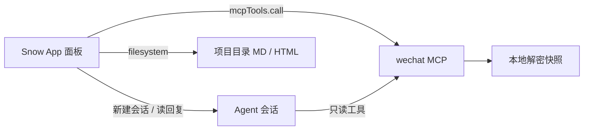

# 微信群聊面板

把本机微信的群聊记录，变成**可浏览的信息流**、**可量化的统计报告**，以及**能追问的 AI 群像分析**。

Snow App 插件（ESM 面板）。数据全部来自本机已安装的 **wechat MCP**（[im-mcp](https://github.com/stkoecn/im-mcp)）——插件本身不采集、不上传、也不向微信发送任何消息。

| 版本 | 许可 | 依赖 |
| --- | --- | --- |
| `0.32.24` | MIT | Snow App ≥ 0.4.27 + wechat MCP |

---

## 为什么需要它

微信桌面端能看消息，但回答不了「这个群最近在聊什么」「谁最能说」「今天的氛围怎么样」。而这些数据其实已经在本机索引里，缺的只是一层把数据变成人能读懂的东西。

这个面板就是那层东西。边界很明确：

- **MCP 负责取数与聚合**：SQL 里能算的（消息量、集中度、成员维度、热词）全部在 MCP 算完，不消耗模型 token。
- **面板负责展示与叙事**：称号、图表、报告结构、AI 提示词都在这里，MCP 里没有一行 Snow App 专属文案。

换一个 MCP 客户端，通用工具照样能用；换一个群，面板不需要改代码。

---

## 功能

| 模块 | 能做什么 |
| --- | --- |
| **信息流** | 群选择、时间范围、关键词搜索、只看媒体 / @、按天分组；真实头像、图片解密直出、合并转发展开 |
| **统计** | 消息 / 人数 / 人均 / 峰值、Gini 集中度、会话片段、24×7 热力、类型占比、群热词、21 个本地称号 |
| **报告** | 日报 / 周报 / 月报 / 年报 / 自定义；导出 Markdown 或自包含 HTML 长图 |
| **成员画像** | 多维榜（发言 / 字数 / 图片 / 表情 / 引用 / 深夜…）、检索榜外成员、AI 角色分析（称号 / 名场面 / 逆天瞬间 / 语言指纹 / 社交位置） |
| **AI 分析** | 单会话分析；四阶段深挖（分段读事实 → 多视角 → 交叉验证 → 成稿）；群聊质量锐评 |
| **MCP 工具台** | 28 个工具直接调用、原始返回、参数按当前群与日期预填；同步与定时同步 |

---

## 架构



### 三条硬约定

改代码前请先确认这三条，它们解释了大多数设计取舍：

1. **MCP 只输出统计事实，面板定义文案与称号。** 「水群王」「逆天瞬间」这类判断全部属于面板；MCP 侧只返回可核验的数字与原文。
2. **样式永不由模型提供。** 模型只写 Markdown 语义（`> [!TIP]`、加粗、表格），渲染由面板统一负责——否则每次输出的样式都不一样，体积还会膨胀。
3. **一份 Markdown，两个后端。** `mdBlockNode`（React 节点）与 `mdToHtml`（长图 HTML）必须同步修改；只改一处就会出现「面板正常、长图错位」。

更细的契约、数据口径与踩坑记录见 [DESIGN.md](./DESIGN.md)。

---

## 快速开始

### 1. 安装 wechat MCP

```bash
uv tool install "im-mcp[wechat]"
# 或：pip install "im-mcp[wechat]"
```

> **必须带 `[wechat]` extra**，否则 `pycryptodome` / `zstandard` 缺失，图片解密与 ETL 会静默失效。

### 2. 初始化本地索引

需要微信已登录，以**管理员身份**运行：

```bash
wechat-init
```

### 3. 在 Snow App 里注册 MCP

设置 → MCP 服务器 → 添加 stdio 服务器。

**名称必须是 `wechat`**——插件按 `wechat-<toolName>` 组装工具全名，名字不一致会导致所有调用失败。

```json
{
  "mcpServers": {
    "wechat": {
      "command": "wechat-mcp",
      "args": [],
      "env": { "PYTHONUTF8": "1", "PYTHONIOENCODING": "utf-8" }
    }
  }
}
```

### 4. 安装插件

**客户端 UI（推荐）**：设置 → 插件 → 面板插件 → 从目录安装 → 选择本目录。

**命令行**：

```
config-set scope=plugins key="new" value={ "sourceDir": "D:/github/snow-app/snow-wechat-panel" }
```

> 安装或更新后**必须重启 Snow App**：面板是 ESM，按 URL 缓存，不重启跑的还是旧代码。MCP 侧是 stdio 短连接，重装后下一次调用即生效。

---

## 使用

### 信息流

- 默认范围是**当天**；改日期、时间或点「今天 / 近 7 天 / 近 30 天」都会立即按新边界重查。
- 关键词搜索走 `search_wechat_messages`，与时间范围可叠加。
- 单次查询上限 200 条，触顶会提示缩小范围；「加载更早」按批次向上翻。
- 图片消息自动解密直出；表情包渲染真图，取不到时静默回退成 `[表情]` 文本。
- 合并转发（`[聊天记录]`）默认收起，点开才发一次 `get_chat_record`。

### 统计与报告

- 本地统计**零 token**：所有数字由 MCP 在 SQL 侧全量聚合。
- 成员榜按维度切换，点头像展开成员画像；群自身账号不计入任何发言人维度。
- 「AI 分析」有两种档位：**单会话**（一轮写完）与**深挖**（四阶段）。面板会按时间跨度与消息量给推荐，但不强制。
- 报告可复制、保存 Markdown、保存 HTML 长图、用内置阅读器打开。

### 成员画像

- 画像取数范围**跟随顶栏时间范围**；改范围后会自动按新口径重取，并在说明行标出实际范围。
- 冷门成员可用「查找成员」按昵称 / 备注 / wxid 检索（不受 Top10 限制）。
- 「不限时间范围」适合潜水成员——今天可能一条都没有。

### MCP 工具台

- 28 个工具按用途分组，参数框已按当前选中的群与日期预填 `session_id` / `start` / `end`。
- 调用后显示 ok / 失败、耗时、返回条数，以及完整返回体。
- **同步是唯一写操作**：`sync_wechat_database` 会重新解密微信源库并重建索引，耗时通常 1–3 分钟，走阻塞调用（避免宿主 120s 超时与后台进程被终止）。
- `set_auto_sync` / `get_auto_sync_status` 可开关定时同步并查看上次结果。

---

## 隐私与权限

`plugin.json` 声明了五个域：

| 域 | 用途 |
| --- | --- |
| `mcpSecrets` | 调用 wechat MCP 工具（`api.write.mcpTools.call` 必需） |
| `conversations` | 新建 AI 分析会话、中止深挖阶段 |
| `messages` | 读取上述会话里 Agent 的回复 |
| `filesystem` | 读取解密导出的图片；把报告写入当前项目 |
| `scheduledTasks` | 创建「定时日报」宿主任务 |

- **ESM 面板等价于本地代码，没有沙箱**——插件页会显示琥珀色标签。
- 实际行为：只读本地微信索引；不读取 API 密钥、不访问网络、不向微信发送消息。
- 唯一的写操作是同步（重建本地索引），且只在用户点击时发生。

完整声明见 `plugin.json` 的 `privacy.note`。

---

## 开发

### 文件结构

| 路径 | 作用 |
| --- | --- |
| `index.js` | 单文件 ESM 面板：数据层、渲染器、提示词、视图 |
| `style.css` | 面板样式（`.swf-*`） |
| `plugin.json` | 清单与隐私声明 |
| `DESIGN.md` | 架构、契约、数据口径与避坑记录 |
| `CHANGELOG.md` | 版本历史（按版本拆分） |
| `test/helpers.test.js` | 数据层纯函数回归测试（不依赖宿主） |

### 约定

- `index.js` 是**单文件 ESM**（`format: esm`、`bundle: true`、`splitting: false`）。
- React 取自 `window.SnowAppPlugin.React`，**不要打包 React / lucide-react**。
- 修改 `plugin.json` 后需要 `rescan`，否则新声明不生效。
- `test/package.json` 声明 `{"type":"commonjs"}`：父目录是 `type: "module"`，不加这行测试文件会被当 ESM 解析而直接报错。

### 测试

```bash
node test/helpers.test.js
```

当前 **78 passed / 0 failed**。测试只覆盖纯函数（解包、分类、时间边界、Markdown 解析、范围文案等），不触碰 React 与宿主 API。

### 发版

1. 同步改 `plugin.json` 与 README 顶部的版本号
2. 把 `DESIGN.md` / `README.md` / `CHANGELOG.md` / `index.js` / `plugin.json` / `style.css` 六个文件打到 zip **根目录**
3. `gh release create vX.Y.Z <zip>`
4. 更新插件市场的四字段：`version` / `tag` / `asset` / `sha256`
5. 本地重装：`config-set scope=plugins key=com.shiroeirin.wechat-feed value={ "sourceDir": "<仓库路径>" }`

---

## 版本记录

完整历史见 **[CHANGELOG.md](./CHANGELOG.md)**；每个版本的安装包与说明见 **[Releases](https://github.com/ShiroEirin/snow-wechat-panel/releases)**。

---

## 许可

MIT
